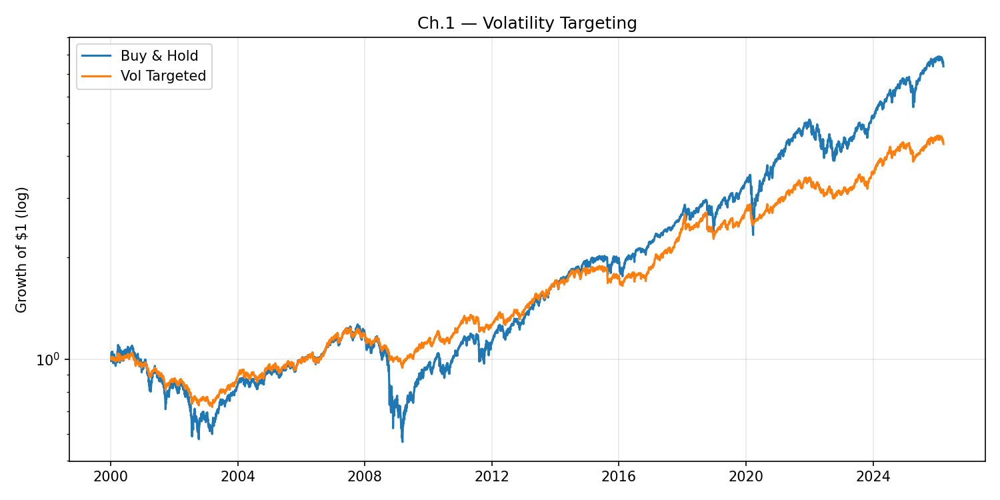
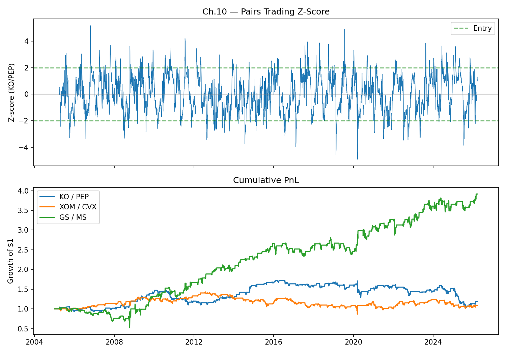

# Paper Alpha

**Fifteen academic trading ideas, translated into Python and put to work on accessible market data.**

Paper Alpha explores what happens when research ideas meet the limitations of everyday data: a familiar result can weaken, a useful risk-control technique can reduce returns, and two seemingly similar pairs can behave very differently. Each chapter implements a simplified strategy or analysis using publicly accessible Yahoo Finance data.

## Results in pictures

### Volatility targeting: the risk-and-return trade-off



In this archived run, volatility targeting reduced exposure during volatile periods. The orange portfolio experienced a shallower decline around the 2008 crisis, while the buy-and-hold portfolio finished higher. The script targets 10% annualized volatility using an EWMA estimate and caps leverage at 2×. The initial volatility estimate uses the first 20 returns; the earliest observations therefore include look-ahead.

### Pairs trading: the choice of pair matters



The upper panel shows the KO/PEP spread's rolling z-score and entry thresholds. The lower panel compares the simulated paths of KO/PEP, XOM/CVX, and GS/MS. In this snapshot, the pairs produced very different trajectories even though the same framework was applied to each.

These charts are archived outputs from **March 2026**, generated from matching versions of the scripts in this repository. The underlying price-data snapshot is not included, so an exact independent reproduction has not been verified. Charts show simulations, not live trading results; scripts do not consistently apply transaction costs. Yahoo Finance data and results change over time.

## The 15 chapters

| # | Strategy or question | Code |
|---|---|---|
| 01 | Volatility targeting | [EWMA volatility and position sizing](ch01_volatility_targeting.py) |
| 02 | Momentum | [12–1 sector momentum](ch02_momentum.py) |
| 03 | Value | [Value versus growth ETFs](ch03_value.py) |
| 04 | Carry | [Currency ETF proxy](ch04_carry.py) |
| 05 | Low volatility | [Low-volatility versus high-beta ETFs](ch05_low_volatility.py) |
| 06 | Trend following | [Multi-asset trend signals](ch06_trend_following.py) |
| 07 | Quality | [Quality versus market ETFs](ch07_quality.py) |
| 08 | Betting against beta | [Low- and high-beta portfolios](ch08_betting_against_beta.py) |
| 09 | Reversal | [Weekly sector reversal](ch09_reversal.py) |
| 10 | Pairs trading | [Rolling spread z-scores](ch10_pairs_trading.py) |
| 11 | Risk parity | [Inverse-volatility allocation](ch11_risk_parity.py) |
| 12 | Factor timing | [Rolling factor comparisons](ch12_factor_timing.py) |
| 13 | Machine learning | [ETF-feature experiment](ch13_ml_alpha.py) |
| 14 | Volatility risk premium | [Implied versus realized volatility](ch14_volatility_risk_premium.py) |
| 15 | Combined strategies | [Trend and risk parity](ch15_combined.py) |

The scripts use proxies and simplified assumptions; they are not direct replications of the underlying academic papers. Chapter 12 compares factors rather than presenting a trading backtest.

## Run an example

```sh
git clone https://github.com/hakvinv/paper-alpha.git
cd paper-alpha
python -m venv .venv
source .venv/bin/activate
pip install -r requirements.txt
python ch01_volatility_targeting.py
```

The scripts need an internet connection to obtain market data. They print summary statistics and save figures in the working directory. See each chapter's source for its data, assumptions and parameters.
